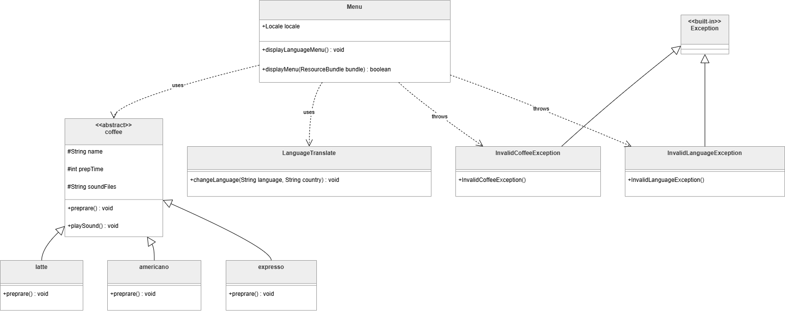

# Coffee Machine (Java)

A console-based coffee machine simulator written in Java. The user picks a language (English or French), chooses a coffee, and the machine plays a sound and "prepares" the drink while the time counts down. Built to practise object-oriented design, custom exceptions, internationalization and multithreading.

> Developed as coursework for a **Adavnced programming** module.


## Features

- **Three coffees:** Americano (6 s), Expresso (3 s) and Latte (4.5 s), each with its own preparation time and sound file.
- **Two languages:** English (`en_GB`) and French (`fr_FR`), switched at runtime using `ResourceBundle` property files.
- **Inheritance and polymorphism:** an abstract `coffee` class with `americano`, `expresso` and `latte` subclasses, each implementing `preprare()`.
- **Custom exceptions:** `InvalidCoffeeException` and `InvalidLanguageException`, with messages translated into the selected language.
- **Multithreading:** each drink is prepared on its own thread, so the progress dots and the "ready" message don't block the menu.
- **Sound:** a `.wav` file plays for each coffee using `javax.sound.sampled`.
- **Logging:** method and constructor calls are logged through the course-provided `AssignmentLogger`.

## Class diagram



## Project structure

```
CoffeeMachine/
├── src/
│   ├── Main/main.java                          Entry point and main loop
│   ├── menu/Menu.java                          Language menu and coffee menu
│   ├── coffeetype/                             coffee (abstract), americano, expresso, latte
│   ├── exceptions/                             InvalidCoffeeException, InvalidLanguageException
│   ├── internationalization/LanguageTranslate.java
│   ├── trans/                                  trans_en_GB.properties, trans_fr_FR.properties
│   └── module-info.java
├── Sound/                                      Americano.wav, Expresso.wav, Latte.wav
└── docs/class-diagram.png
```

## Requirements

- **Java 21** or later (the project was built with JDK 21 and run on JDK 24)
- **`logger.jar`**, the logging library supplied by the module. It is **not included** in this repository. Download it from your course material and keep it somewhere you can reference.
- Speakers or headphones for the sound

## Running the project

### Eclipse (recommended)

1. Clone this repository and import it with **File > Import > Existing Projects into Workspace**.
2. Right-click the project > **Build Path > Configure Build Path > Modulepath > Add External JARs...** and add `logger.jar`.
3. Make sure the **Sound** folder is in the project root. Sound paths are relative to the working directory.
4. Run `Main/main.java` as a Java Application.

### Command line (Windows example, untested)

From the project root, with `logger.jar` in a `lib` folder:

```bat
dir /s /b src\*.java > sources.txt
javac --module-path lib\logger.jar -d bin @sources.txt
xcopy src\trans\*.properties bin\trans\ /Y
java --module-path "bin;lib\logger.jar" -m CoffeeMachine/Main.main
```

The program must be started from the project root so that `Sound/*.wav` is found.

## Usage

```
Choose the language
1.English
2.French
3.Exiting...
> 1

Choose the coffee
1.Americano
2.Expresso
3.Latte
4.Exiting...
5.Back
> 2

Preparing Expresso
Playing sound files: Sound/Expresso.wav
Preparing
...
Your Expresso is ready
```
*(abridged)*

| Menu | Option | Action |
|---|---|---|
| Language | 1 / 2 | Switch to English / French |
| Language | 3 | Exit the program |
| Coffee | 1 / 2 / 3 | Make Americano / Expresso / Latte |
| Coffee | 4 | Exit the program |
| Coffee | 5 | Go back to the language menu |

Entering any other number shows a translated error message (`Invalid coffee type` or `Invalid language`) and returns to the language menu.

## Known limitations

- Non-numeric input (for example a letter) is not handled and will throw an `InputMismatchException`.
- The sound plays for a fixed 3 seconds before the preparation timer starts.
- Translations for new languages require adding a `trans_xx_XX.properties` file and a menu option.

## Possible improvements

- Validate non-numeric input.
- Load coffee types from a configuration file.
- Add more languages and drinks.

## Notes

The design and code are my own coursework. I used Claude (an AI assistant) afterwards to help write this README and tidy the repository.
